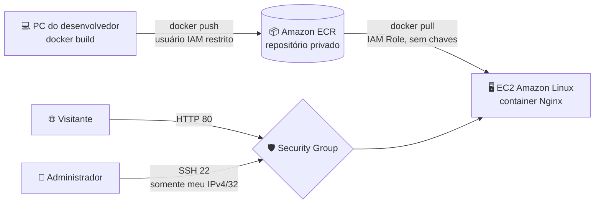

# 🚀 Deploy seguro de site containerizado na AWS (Docker + ECR + EC2)

Projeto de estudo de **Cloud e DevSecOps**: um site estático empacotado em Docker, publicado no **Amazon ECR** e executado numa instância **EC2**, seguindo boas práticas de segurança (menor privilégio, sem credenciais no servidor, acesso SSH restrito).

> 🔗 **Demo:** http://SEU_IP_OU_DOMINIO *(a instância pode estar desligada para economizar custos)*

---

## 🏗️ Arquitetura



## 🧰 Tecnologias

| Camada | Ferramenta |
|---|---|
| Aplicação | HTML/CSS/JS servido por **Nginx (alpine)** |
| Container | **Docker** |
| Registro de imagens | **Amazon ECR** (us-east-2) |
| Computação | **Amazon EC2** t3.micro, Amazon Linux |
| Identidade e acesso | **AWS IAM** (usuário restrito + role para a EC2) |
| Rede | **Security Groups** |

## 📁 Estrutura

```
.
├── website/          # arquivos do site
├── Dockerfile
├── .dockerignore
├── .gitignore
└── README.md
```

## 🔐 Decisões de segurança

- **Nenhuma credencial dentro da EC2.** A instância acessa o ECR por uma **IAM Role** (`AmazonEC2ContainerRegistryReadOnly`), que gera credenciais temporárias e renovadas automaticamente. Se o servidor for comprometido, não existe chave para ser roubada, e a role só permite *ler* imagens.
- **Menor privilégio no IAM.** Contas separadas por função:
  - **root**: só cobrança e emergências, com MFA
  - **usuário administrador**: uso diário no console, com MFA
  - **usuário da CLI**: só as permissões necessárias para `docker push` no ECR
- **SSH restrito.** A porta 22 aceita apenas o meu IPv4 com máscara `/32`. HTTP (80) é público.
- **Imagem enxuta.** Base `nginx:alpine`, que tem menos pacotes e, portanto, menos superfície de ataque.
- **Segredos fora do Git.** `.pem`, `.env` e credenciais estão no `.gitignore`.

## ▶️ Como reproduzir

### 1. Build e push (máquina local)
```bash
aws ecr get-login-password --region us-east-2 | docker login --username AWS --password-stdin <ACCOUNT_ID>.dkr.ecr.us-east-2.amazonaws.com

docker build -t rains:v1.0 .
docker tag rains:v1.0 <ACCOUNT_ID>.dkr.ecr.us-east-2.amazonaws.com/rains:v1.0
docker push <ACCOUNT_ID>.dkr.ecr.us-east-2.amazonaws.com/rains:v1.0
```

### 2. Deploy (na EC2, com a IAM Role anexada)
```bash
sudo dnf install docker -y
sudo systemctl enable --now docker
sudo usermod -aG docker ec2-user   # sair e entrar de novo no SSH

aws ecr get-login-password --region us-east-2 | docker login --username AWS --password-stdin <ACCOUNT_ID>.dkr.ecr.us-east-2.amazonaws.com
docker pull <ACCOUNT_ID>.dkr.ecr.us-east-2.amazonaws.com/rains:v1.0
docker run -d -p 80:80 --restart unless-stopped --name site-container <ACCOUNT_ID>.dkr.ecr.us-east-2.amazonaws.com/rains:v1.0
```

## 🐞 Problemas encontrados e como resolvi

| Problema | Causa | Solução |
|---|---|---|
| SSH recusado mesmo com "Meu IP" liberado | O console detectou meu **IPv6** (`/32` = bloco inteiro da operadora), mas o SSH saía por **IPv4** | Regra recriada com o IPv4 em `/32`. Isso também fechou o acesso que estava aberto para milhões de IPs da operadora |
| AWS não aceitava trocar IPv6 por IPv4 na mesma regra | Limitação do Security Group | Excluir a regra e criar uma nova |
| `NoCredentials` ao logar no ECR pela EC2 | Instância sem identidade na AWS | Criar e anexar uma **IAM Role** em vez de guardar chaves no servidor |
| Site não abria no navegador | O navegador forçava **HTTPS** e só a porta 80 estava em uso | Acessar com `http://` explícito (próximo passo: HTTPS) |
| `COPY failed: not found` no build | Nome da pasta digitado errado no Dockerfile | Corrigir o caminho, relativo ao contexto do build |

**Diagnóstico de rede que aprendi:** `Connection timed out` costuma indicar bloqueio por firewall/Security Group. Já `Connection refused` indica que o pacote chegou, mas nada respondeu na porta. Usei `Test-NetConnection` e `curl -I` para isolar cada camada.

## 🗺️ Próximos passos

- [ ] Domínio próprio + **HTTPS** (Caddy ou Nginx + Let's Encrypt)
- [ ] **Elastic IP**
- [ ] Script de **User Data** para provisionar a instância automaticamente
- [ ] Pipeline **CI/CD** com GitHub Actions (build → scan → push → deploy)
- [ ] Scan de vulnerabilidades da imagem com **Trivy**
- [ ] Hardening do host (atualizações automáticas, fail2ban)
- [ ] Infraestrutura como código com **Terraform**

## 📸 Evidências

<!-- Adicione prints com dados sensíveis borrados -->
| Site no ar | Container rodando | Regras do Security Group |
|---|---|---|
|  |  |  |

---

👤 **Caetano Nascimento**, desenvolvedor em transição para Segurança da Informação (AppSec / DevSecOps)
[LinkedIn](https://linkedin.com/in/SEU-PERFIL) · [GitHub](https://github.com/SEU-USUARIO)
